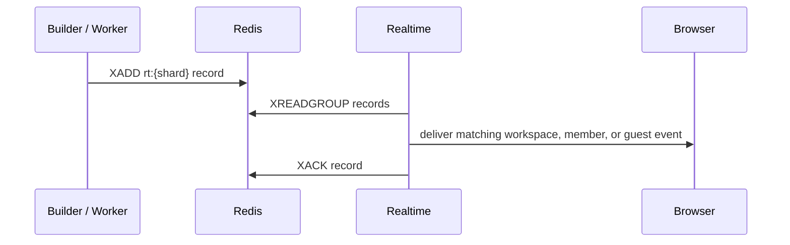

# Workspace realtime relay

Workspace browsers connect to the Realtime service with a short-lived,
purpose-bound JWT. Builder mints member tokens after resolving membership and
scope; Realtime validates the workspace audience, purpose, expiry, and the
`realtime:revoked:<workspaceId>:<userId>` cutoff before accepting a socket.

Records are retained for approximately five minutes and capped at 10,000
entries per shard. Replay is best-effort; clients must recover authoritative
state through their normal data queries after reconnecting.

Workspace events coalesce for 25 ms before publishing. Member revocations are
not coalesced: the record includes `revokedAtMs`, so a socket with a newer
`iatMs` is not closed by a delayed retry.
